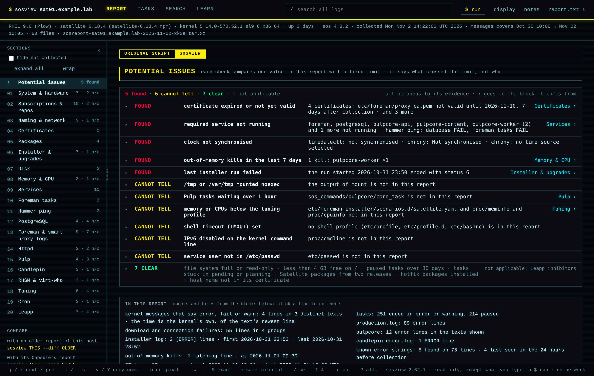
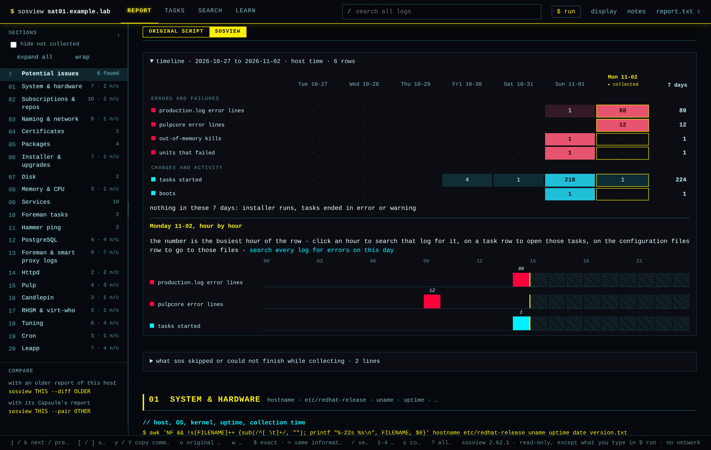
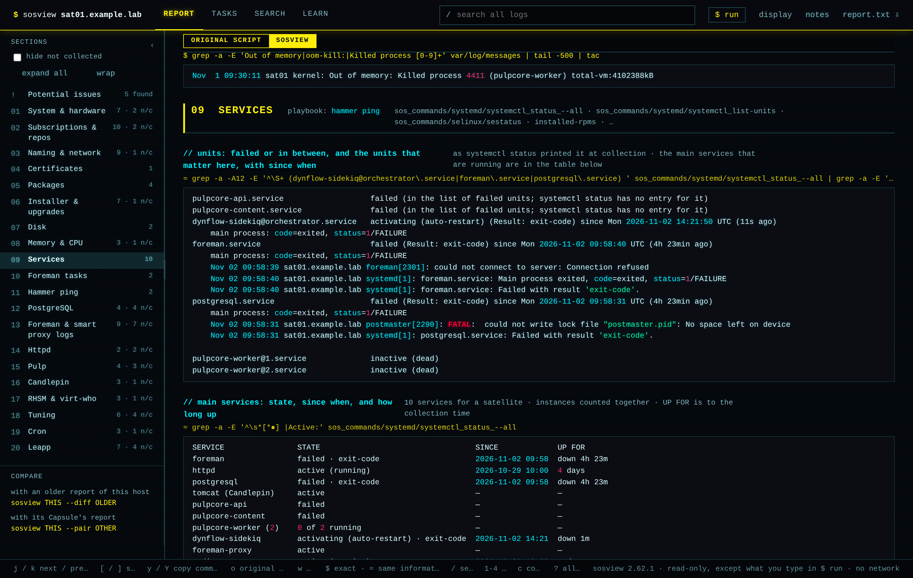
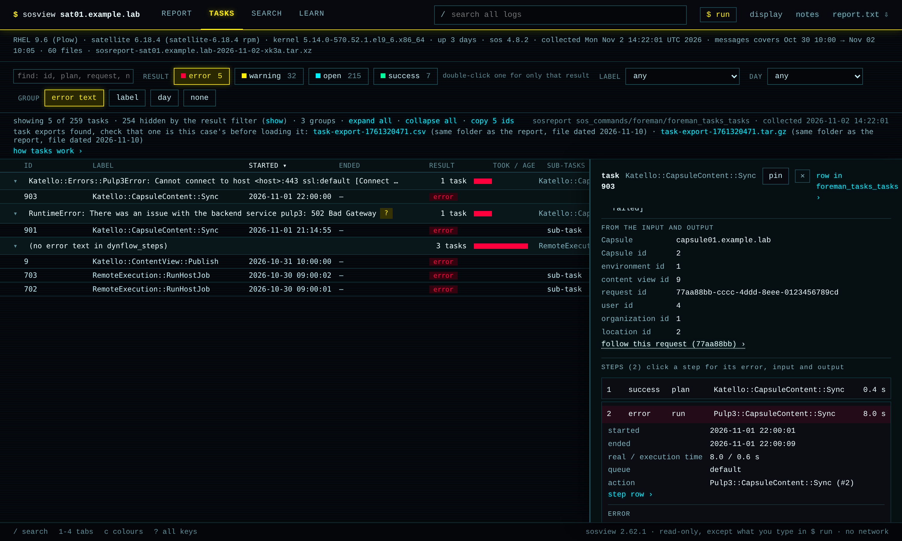
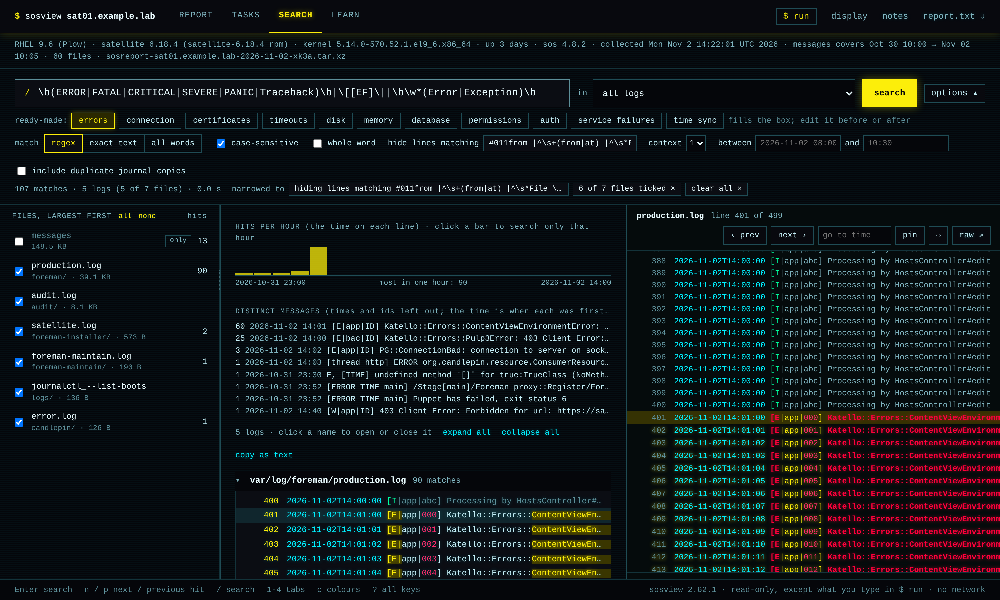
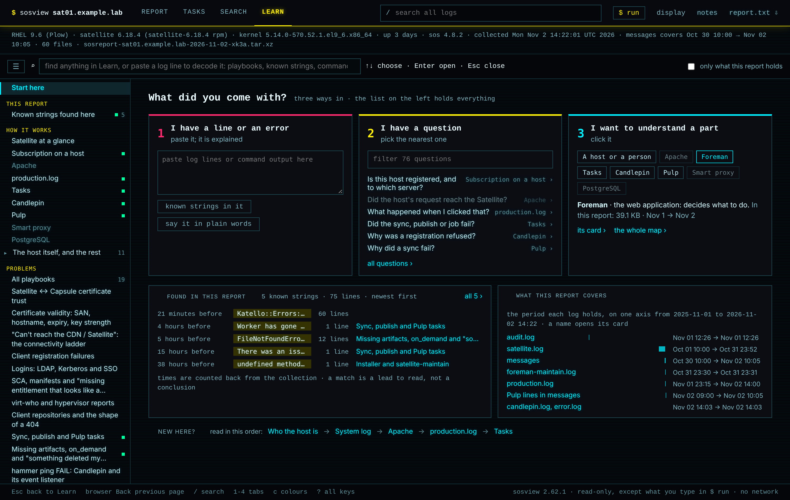

# sosview

sosview opens a sosreport from a Red Hat Satellite, a Capsule or a plain RHEL host and lays it out as one page you can read, click through and search. It is a single Python file. It needs nothing installed, it does not use the network, and it never changes the report.

It covers RHEL 7 to 10 and Satellite 6.14 to 6.20.



Every screenshot on this page shows a made-up example host.

## Quick start

```
python3 sosview.py serve sosreport-myhost-2026-11-02-abcd.tar.xz
```

This prints a local address and opens it in your browser. Press Ctrl-C in the terminal when you are done.

You can pass the tarball as it is (`.tar.xz`, `.tar.gz`, `.tar.bz2`) or a directory you already extracted.

## What you need

- Python 3.6 or later. Only the standard library is used.
- bash, for the original analysis script view. Without it that view is skipped and everything else works.
- A browser.

Linux and macOS are supported.

## What you get

The page has four tabs. Keys `1` to `4` switch between them.

### Report

- **Potential issues** at the top: nineteen checks, each comparing one value in the report with a fixed limit. Examples: an expired certificate, a main service that is not running, a full or read-only file system, a clock that is not synchronised, a failed installer run, tasks paused for more than 30 days, out-of-memory kills in the last week.
- **A timeline** of the seven days before the report was collected: errors, failed units, tasks, installer runs, package changes and boots, counted per day and per hour.
- **Twenty sections** in a fixed order: system, subscriptions and repos, network, certificates, packages, installer, disk, memory and CPU, services, tasks, hammer ping, PostgreSQL, Foreman logs, httpd, Pulp, Candlepin, rhsm and virt-who, tuning, cron, leapp.
- **Every block shows the shell command behind it.** Run that command in the extracted report and you get the same lines.
- **Lines are links.** In serve mode, a line that came from a log opens that log at that line. Task ids open the task.
- **Two views.** The Report opens on the output of the original analysis script, with corrections so its commands work on current Satellites. The button at the top (or the `o` key) switches to sosview's own view.





### Tasks

The Foreman tasks that are already inside the sosreport, so most of the time you do not need a separate task export.

- Filter by result: error, warning, open or success.
- Tasks are grouped, with sub-tasks under their parent.
- Open a task to see it from start to end: state, result, how long it took, each step with its time, and the error where it stopped.
- A sosreport keeps about the last month of tasks. For anything older, load a task export next to the report (see below).
- A task export also opens on its own, without a sosreport. You get the Tasks tab alone; what reads the logs (following a request, the log lines around a task) needs the sosreport as well.



### Search

Searches every log in the report from one box.

- Exact text, all words in any order, or a regular expression.
- Case-sensitive, whole word, lines of context around a hit, and a time window.
- Ready-made searches for common errors.
- A hit opens the log on the right, at that line.



### Learn

Playbooks for common Satellite problems, a list of known error strings with one known cause each, and a glossary. This tab is still growing.



## Commands

```
sosview.py serve REPORT                 the page on localhost, with Search, file viewing and full task records
sosview.py serve REPORT TASK-EXPORT     the same, with a task export loaded on the Tasks tab
sosview.py serve TASK-EXPORT            a task export on its own: the Tasks tab alone
sosview.py REPORT                       write REPORT.txt and REPORT.html next to the report and open the page
sosview.py REPORT --text | less         the text report in the terminal (--full to not cut long blocks)
sosview.py SATELLITE --pair CAPSULE     compare certificate trust between a Satellite and a Capsule
sosview.py NEW --diff OLD               add a section with what changed between two reports of the same host
sosview.py REPORT --no-original         skip the original analysis script
sosview.py --install                    copy the program to ~/.local/bin/sosview
```

Other options: `-o DIR` (where to write the files), `--no-open`, `--port PORT`, `--keep` (keep the extracted copy), `--version`.

## Saved page or serve

The saved `.html` is one file you can keep or attach. It holds the Report, the Tasks list and Learn. Search, opening files and full task records need a running program behind the page, so use `serve` for those.

## Good to know

- **Where files go.** A tarball is extracted to `/var/tmp` (or `$TMPDIR`) and removed when sosview exits. The written `.txt`, `.html` and `.log` are readable by their owner only, because they hold what the sosreport holds.
- **Nothing is hidden.** sosview shows what is in the report. If the report was collected with host names or addresses obscured, they stay obscured.
- **Serve mode is local.** It answers on `127.0.0.1` and `localhost` only. To use it on another machine, open an SSH tunnel: `ssh -L 8080:127.0.0.1:PORT host`, then open the printed address with port 8080.
- **Speed.** A typical report takes a few seconds to about 20 seconds. A large Satellite report can take a minute or so.
- **Damaged tarballs** are read as far as they go, and the page says where reading stopped.
- **Logs without a year** (syslog, journal) get their year worked out from the collection date.

## The smaller build

`sosview-lite.py` is the same program without the Learn tab. It takes the same commands, is about a third of the size and writes its page in under half the time.

## Themes and keys

Four themes: neon (the default), dark, light and inferno; `t` switches. `/` jumps to search, `o` switches Report views, `c` turns log colours off and on.
